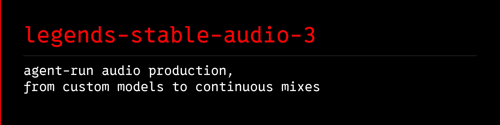
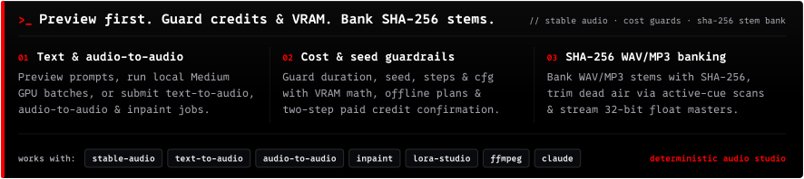
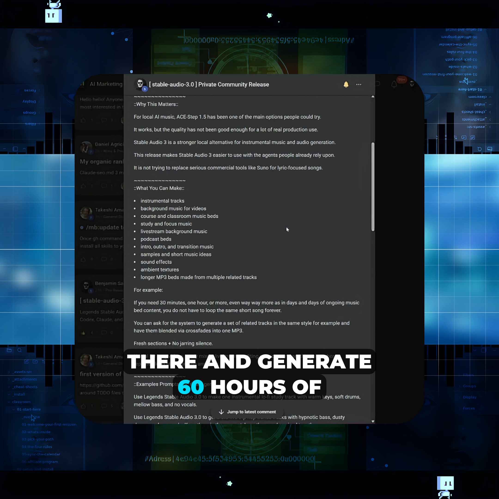
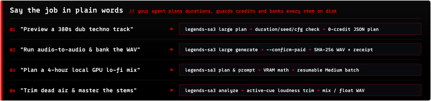
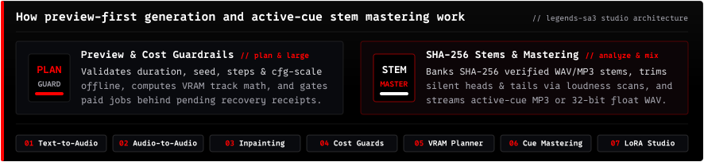
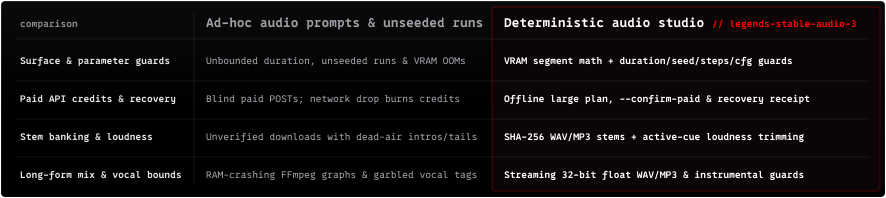

<a name="banner"></a>
<a name="legends-stable-audio-3"></a>

# 

[](https://github.com/avalonreset/legends-stable-audio-3/releases/latest)
[](https://github.com/avalonreset/legends-stable-audio-3/actions/workflows/ci.yml)
[](pyproject.toml)
[](docs/AGENT-RECIPE.md)
[](LICENSE)

**Deterministic Stable Audio CLI studio (`legends-sa3`) for coding agents: preview-first text-to-audio, audio-to-audio, and inpainting generation, duration/seed/steps/cfg-scale parameter and credit guardrails, VRAM-calibrated local GPU batches, SHA-256 WAV/MP3 stem banking, and active-cue loudness mastering.**


```text
Install or update legends-stable-audio-3 via cto-legends (https://github.com/avalonreset/cto-legends): run `cto-legends install legends-stable-audio-3 --apply`, then `cto-legends handoff legends-stable-audio-3` and follow the returned JSON recipe to verify `legends-sa3`.
```



<p align="left">
  <a href="https://www.youtube.com/watch?v=ZMF28c_M7OU">
    
  </a>
</p>
<p align="left">
  <a href="https://www.youtube.com/watch?v=ZMF28c_M7OU"><em>just use freaking stable-audio-3 for all of your music beds from now on</em></a>
</p>

## Why `legends-stable-audio-3` exists

Most ad-hoc generative audio scripts break down as soon as a coding agent moves past a single toy clip:

1. **Unbounded durations, unseeded prompts, and GPU OOM crashes:** Asking an agent to "make a 2-hour background track" without hardware-calibrated segment math or explicit `duration`, `seed`, `steps`, and `cfg_scale` bounds either crashes local VRAM mid-render or produces unrepeatable clips with garbled vocal artifacts.
2. **Blind paid API calls and lost generation credits:** Firing raw HTTP POST requests at hosted Stable Audio endpoints without an offline plan check or an immediate on-disk recovery receipt means any transient network drop during polling forces your agent to re-submit and double-bill your account.
3. **Dead-air intros and RAM-crashing FFmpeg filter graphs:** Generative audio models frequently pad track heads and tails with near-silent dead air. Feeding thirty raw tracks into a single monolithic FFmpeg filter graph exhausts workstation memory and leaves awkward silent gaps at every crossfade before you can score a video for [`legends-youtube`](https://github.com/avalonreset/legends-youtube), [`legends-captions`](https://github.com/avalonreset/legends-captions), or [`legends-obs`](https://github.com/avalonreset/legends-obs).

`legends-stable-audio-3` gives coding agents a deterministic audio studio via the `legends-sa3` CLI. It keeps local Medium GPU inference, guarded hosted Large API jobs (`text-to-audio`, `audio-to-audio`, and `inpaint`), pinned Underfit LoRA adapter training, and active-cue floating-point stem mastering distinct and verifiable.

## Ask in plain english

Once [`cto-legends`](https://github.com/avalonreset/cto-legends) is installed, you ask your coding agent in plain english. It previews prompts and parameter bounds offline first, enforces credit and VRAM guardrails, banks every WAV or MP3 stem with SHA-256 provenance, and trims dead air before mastering:



## Architecture: preview-first guardrails and active-cue stem mastering



### 1. Preview-first generation, parameter bounds, and two-step credit guardrails (`plan` and `large`)

Before touching GPU weights or spending a single hosted API credit, `legends-sa3` validates every parameter offline:

- **Zero-cost hosted request planning (`legends-sa3 large plan`):** Validates `operation` (`text-to-audio`, `audio-to-audio`, or `inpaint`), `duration` (`1..380` seconds, defaulting to `380s` for full songs), `seed`, `steps` (`4..8`), `cfg-scale` (`1..25`), `strength`, and `mask-start`/`mask-end`, and preflights local reference audio with `ffprobe` (`<= 100 MiB`, symlink-refused).
- **Two-step paid confirmation and crash recovery (`legends-sa3 large generate` and `large result`):** Live hosted jobs require both `--confirmed-live-credits <n>` and `--confirm-paid`. Immediately upon submission, `legends-sa3` writes a secret-free pending receipt containing the remote `generation_id` before polling begins. Paid POST requests are never automatically retried; interrupted downloads resume cleanly via `legends-sa3 large result --generation-id <id>` and verify the downloaded WAV/MP3 bytes and SHA-256 digest before writing.
- **VRAM-calibrated local Medium planning (`legends-sa3 plan` and `prompt`):** Calculates recommended per-track durations (`90s..120s` on 8 GB VRAM up to `360s..380s` on 24 GB VRAM), crossfade overlap deductions, and exact segment counts on CPU, while formatting structured instrumental metadata (`TrackType`, `VocalType: Instrumental`, BPM, and vocal-blocking negative guidance).

### 2. Complete `legends-sa3` CLI surface

| Surface | `legends-sa3` Subcommands | What It Does |
| :--- | :--- | :--- |
| **Readiness & Model Access** | `doctor`, `download-model`, `skill` | Offline hardware/FFmpeg/PyTorch/VRAM inspection (`doctor --offline`), revision-pinned Hugging Face download of gated `stable-audio-3-medium` and `t5gemma` weights after user terms acceptance (`download-model`), and portable recipe bundle validation (`skill validate`, `skill install`). |
| **Prompt & Runtime Planning** | `prompt`, `plan`, `production-plan` | Expand free-form style notes or built-in recipes (`lofi-study`, `trip-hop-trance`) into structured prompts (`prompt`), compute VRAM-aware local batch geometry (`plan`), or plan full-song hosted production sets with credit estimates (`production-plan`). |
| **Guarded Hosted Large API** | `large plan`, `large generate`, `large result` | Preview hosted `text-to-audio`, `audio-to-audio`, and `inpaint` payloads offline (`large plan`), execute credit-confirmed jobs with atomic pending receipts (`large generate`), and recover interrupted downloads without double-billing (`large result`). |
| **Local GPU Batches & LoRA Studio** | `generate`, `lora-studio` | Run resumable local Medium GPU batches with sequential seeds and `.safetensors`-verified LoRA/DoRA checkpoints (`generate`), or manage a commit-pinned (`8a96800a...`) Underfit LoRA training checkout and checksum-verified adapter registry (`lora-studio status`, `install`, `import`, `list-adapters`). |
| **Active-Cue Analysis & Mastering** | `analyze`, `mix`, `arrange` | Scan generated stems in 100 ms decibel windows to detect near-silent heads/tails and active cues (`analyze`), stream sequential 32-bit float crossfades into a continuous 320 kbps MP3 master (`mix`), or render a per-pair cue sheet into unclipped 32-bit float WAV (`arrange`). |

### 3. SHA-256 stem banking and active-cue loudness mastering (`analyze`, `mix`, and `arrange`)

- **Loudness-scanned dead-air trimming (`--mix-policy active-cue`):** Generative tracks often begin or end with quiet padding that wastes a uniform crossfade window. `legends-sa3 analyze` and `mix` decode each stem into 32-bit floating-point PCM (`512 MiB` bounded), scan peak and RMS decibel thresholds (`--cue-threshold-db -50.0`, `--silence-threshold-db -80.0`), trim silent heads and tails, lock incoming transitions onto active musical cues, and protect the first and final tracks from artificial fades.
- **Sequential streaming and SHA-256 manifests:** Instead of building one massive FFmpeg filter graph that exhausts RAM across multi-hour mixes, `legends-sa3` streams transitions pair by pair and writes a verified JSON manifest recording source SHA-256 hashes, per-track trims, cue warnings, and `ffprobe`-verified master duration.

## Ad-hoc audio prompts vs `legends-stable-audio-3`



<a name="local-medium-quick-start"></a>

## Quick start

```sh
# 1. Verify local runtime, FFmpeg, and GPU/VRAM readiness offline
legends-sa3 doctor --offline
legends-sa3 skill validate

# 2. Preview expanded instrumental prompts and calculate a multi-hour mix plan on CPU
legends-sa3 prompt --style "trance hip hop jazz, smoky saxophone, broken beat drums, 104 BPM" --count 3
legends-sa3 plan --hours 4 --vram-gb 24 --crossfade 12

# 3. Preview a hosted Large text-to-audio or audio-to-audio request offline (0 credits spent)
legends-sa3 large plan \
  --operation text-to-audio \
  --prompt "TrackType: Music, VocalType: Instrumental, deep dub techno, 118 BPM" \
  --duration 380 --seed 42 --steps 8 --cfg-scale 1 --output-format wav

# 4. Run a credit-confirmed hosted job or recover an existing generation ID
legends-sa3 large generate \
  --operation text-to-audio \
  --prompt "TrackType: Music, VocalType: Instrumental, deep dub techno, 118 BPM" \
  --duration 380 --seed 42 --steps 8 --cfg-scale 1 --output-format wav \
  --output ./output/dub-techno.wav \
  --confirmed-live-credits 26 --confirm-paid
legends-sa3 large result --generation-id <id> --output ./output/dub-techno.wav

# 5. Analyze stems for quiet intros/tails and render an active-cue MP3 or float WAV master
legends-sa3 analyze --input-dir ./output/tracks_mp3 --json-output ./output/track-analysis.json
legends-sa3 mix --input-dir ./output/tracks_mp3 --output ./output/master-mix.mp3 --crossfade 12 --mix-policy active-cue
legends-sa3 production-plan --minutes 20
legends-sa3 arrange --plan arrangement.json --output ./output/arrangement-float.wav
```

<a name="documentation"></a>

## Reference

<details>
<summary><strong>Local Medium GPU generation, gated weights, and Underfit LoRA Studio</strong></summary>

Before running `legends-sa3 download-model`, accept Stability AI's terms for the gated model and bundled T5Gemma conditioner on Hugging Face, then authenticate with `hf auth login`. `legends-stable-audio-3` never bundles, mirrors, or redistributes model weights.

```sh
# Download gated Medium weights after accepting Hugging Face terms (excludes pickle formats)
legends-sa3 download-model --model medium --output ./models/stable-audio-3-medium

# Generate a resumable local GPU batch with optional .safetensors LoRA adapter
legends-sa3 generate \
  --model-dir ./models/stable-audio-3-medium \
  --stable-audio-repo ../stable-audio-3 \
  --style "lo-fi study hip hop, warm Rhodes, soft boom bap drums, no vocals" \
  --minutes 20 \
  --vram-gb 24 \
  --output ./output/lofi-study

# Inspect or import a trained .safetensors checkpoint from pinned Underfit LoRA Studio
legends-sa3 lora-studio status
legends-sa3 lora-studio import ./state/runs/my-style/5000.safetensors --name my-style --source-run my-style
legends-sa3 lora-studio list-adapters
```

See [first-run guide](docs/first-run.md), [model access](docs/model-access.md), [VRAM guide](docs/vram-guide.md), [prompting guide](docs/prompting-guide.md), [LoRA adapters](docs/lora-adapters.md), and [LoRA Studio with Underfit](docs/lora-studio.md).

</details>

<details>
<summary><strong>Agent setup (via <code>cto-legends</code>) and standalone installation</strong></summary>

### Agent setup (via `cto-legends`)

Part of [cto-legends](https://github.com/avalonreset/cto-legends). The central router skill is vendored at [skills/cto-legends/SKILL.md](skills/cto-legends/SKILL.md); this module is not a separate registered skill and does not require an ambient MCP daemon.

Run `cto-legends handoff legends-stable-audio-3` and read the returned installed recipe and task-readiness checks. If the module is missing, preview setup with `cto-legends install legends-stable-audio-3`, perform the authorized setup, then repeat the handoff. Use `cto-legends check-updates` to compare your installed version with the catalog and published release. See [docs/AGENT-RECIPE.md](docs/AGENT-RECIPE.md) for the standalone recipe.

```sh
python -m venv .venv
python -m pip install -e ".[download]"
legends-sa3 doctor --offline
legends-sa3 skill validate
```

Set `STABILITY_API_KEY` in your environment only when submitting or polling hosted Large API jobs. Secrets are redacted from all receipts and logs.

</details>

<details>
<summary><strong>Documentation index, verification, and scope boundaries</strong></summary>

- **Guides & references:** [Agent recipe](docs/AGENT-RECIPE.md) · [First run](docs/first-run.md) · [Model access](docs/model-access.md) · [Prompting guide](docs/prompting-guide.md) · [Full-song Large strategy](docs/large-prompting-guide.md) · [Cue-sheet arrangement](docs/arrangement.md) · [Continuous mix workflow](docs/music-factory.md) · [LoRA adapters](docs/lora-adapters.md) · [LoRA Studio](docs/lora-studio.md) · [VRAM guide](docs/vram-guide.md) · [Hosted surfaces and receipts](docs/hosted-surfaces-and-receipts.md) · [Large REST reference](src/legends_sa3/_bundled_skill/legends-stable-audio-3/references/large-api.md) · [Platform support](docs/platform-support.md) · [Agent compatibility](docs/agent-compatibility.md) · [Commercial use and license notes](docs/commercial-use-and-license.md) · [Apache-2.0 source license record](docs/source-license-decision.md) · [Dependency policy](docs/dependency-policy.md) · [Troubleshooting](docs/troubleshooting.md) · [Release checklist](docs/release-checklist.md)
- **Scope boundaries:** `legends-stable-audio-3` is not a lyric-to-vocal pop song generator (Stable Audio models do not reliably synthesize intelligible sung lyrics; `--allow-vocals` only permits vocal-like ambient textures). It does not bypass Hugging Face gated model terms, and its Apache-2.0 source license covers project-owned code and documentation only (not third-party model weights, datasets, adapters, hosted services, or generated media).

```sh
python -m pytest tests -v
python scripts/release_checks.py
python scripts/check_release.py
```

</details>

## Contributing, security, and license

See [CONTRIBUTING.md](CONTRIBUTING.md), [SUPPORT.md](SUPPORT.md), and [SECURITY.md](SECURITY.md).

Project-owned source, documentation, tests, and banner assets are licensed under [Apache License 2.0](LICENSE). See [NOTICE](NOTICE), [THIRD_PARTY_NOTICES.md](THIRD_PARTY_NOTICES.md), and [assets/PROVENANCE.md](assets/PROVENANCE.md). `legends-stable-audio-3` is an independent compatibility project and is not affiliated with, sponsored by, or endorsed by Stability AI. Copyright (c) 2026 Avalon Reset.

[](https://github.com/avalonreset/cto-legends/issues/new?title=Message%20for%20Avalon%20Reset&labels=message)

<p align="center"><a href="https://github.com/stars/avalonreset/lists/cto-legends"></a></p>

**Specification & benchmarks on cto-legends.com:**
- **Module specification & architecture matrix:** [cto-legends.com/modules/legends-stable-audio-3](https://cto-legends.com/modules/legends-stable-audio-3)
- **Related engineering dispatches:** [How to Build AI Agents: Production CLI & MCP Routing](https://cto-legends.com/blog?post=how-to-build-ai-agents-cli-mcp-routing) · [Claude Code Skills: MCP vs CLI Workflow Architecture](https://cto-legends.com/blog?post=claude-code-skills-mcp-vs-cli-workflow)
- **Ecosystem hub:** [cto-legends.com/home](https://cto-legends.com/home)
